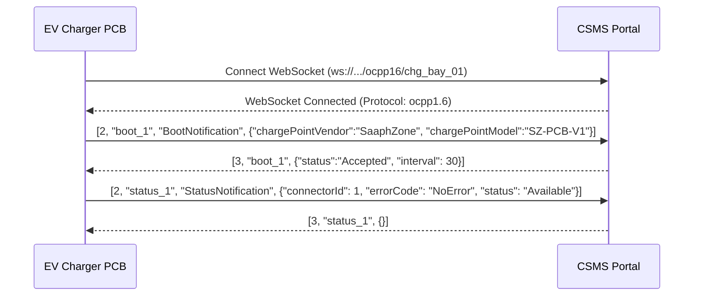
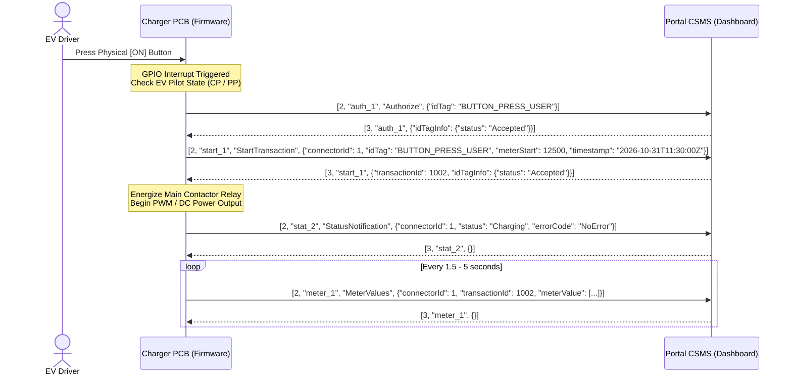
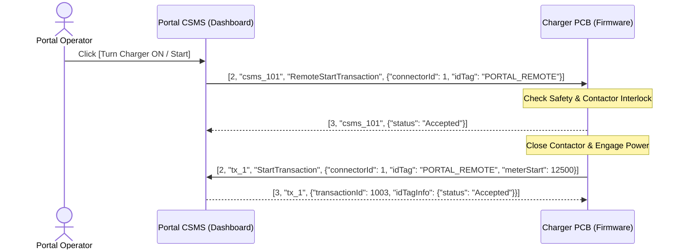
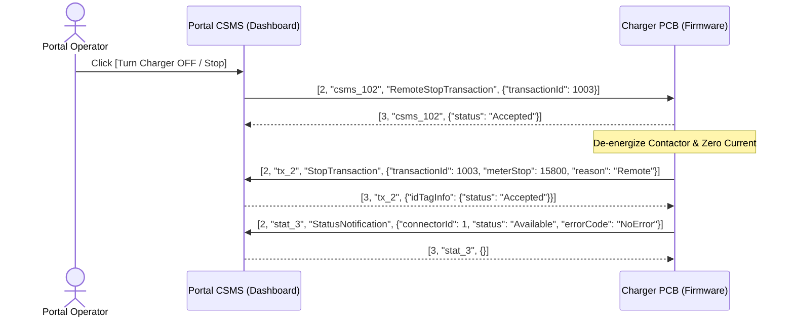

# OCPP 1.6-J Embedded Firmware & Hardware Integration Guide

This guide describes how to connect your physical EV Charger PCB controller (ESP32, STM32, Arduino, Raspberry Pi, or custom RTOS microcontroller) to the **SaaphZone Charger Portal (CSMS)** using **OCPP 1.6-J (JSON over WebSockets)**.

---

## 1. Network & Protocol Specifications

| Parameter | Value |
| :--- | :--- |
| **Protocol** | **OCPP 1.6-J** (Open Charge Point Protocol 1.6 JSON) |
| **Transport** | WebSockets (`ws://` plain or `wss://` TLS) |
| **Subprotocol** | `ocpp1.6` (`Sec-WebSocket-Protocol: ocpp1.6`) |
| **Server Endpoint** | `ws://<PORTAL_HOST_OR_IP>:3000/ocpp16/<CHARGER_ID>` |
| **Example URL** | `ws://192.168.1.50:3000/ocpp16/chg_bay_01` |
| **Message Framing** | Standard JSON Array `[MessageTypeId, "<UniqueId>", ...]` |

### OCPP Message Type IDs:
- **`2` = CALL**: Request from sender to receiver: `[2, "<UniqueId>", "<Action>", { <Payload> }]`
- **`3` = CALLRESULT**: Successful response: `[3, "<UniqueId>", { <Payload> }]`
- **`4` = CALLERROR**: Error response: `[4, "<UniqueId>", "<ErrorCode>", "<Description>", {}]`

---

## 2. Boot & Initial Connection Sequence

When the PCB powers on, connect the WebSocket and perform the initial handshake:



---

## 3. FLOW 1: Physical Charger ON Button Pressed

### Sequence:
1. User presses the **Charger ON** button on the physical charger.
2. The PCB microcontroller receives the button interrupt, runs safety & pilot interlock checks.
3. The PCB sends `Authorize` or `StartTransaction` to the Portal.
4. The Portal responds with `{ "status": "Accepted", "transactionId": 1002 }`.
5. The PCB closes the main contactor/relays and starts power delivery.
6. The PCB sends continuous `MeterValues` (Voltage, Current, Power, SoC, Energy).



---

## 4. FLOW 2: Remote Control from Portal (Turn ON / Turn OFF)

### Remote Start (Turn ON from Portal):


### Remote Stop (Turn OFF from Portal):


---

## 5. Live Telemetry Packet (MeterValues)

Send periodic meter updates while charging:

```json
[
  2,
  "mv_101",
  "MeterValues",
  {
    "connectorId": 1,
    "transactionId": 1002,
    "meterValue": [
      {
        "timestamp": "2026-10-31T11:32:00.000Z",
        "sampledValue": [
          { "value": "418.5", "measurand": "Voltage", "unit": "V" },
          { "value": "148.2", "measurand": "Current.Import", "unit": "A" },
          { "value": "62.0", "measurand": "Power.Active.Import", "unit": "kW" },
          { "value": "78.5", "measurand": "SoC", "unit": "Percent" },
          { "value": "15800", "measurand": "Energy.Active.Import.Register", "unit": "Wh" },
          { "value": "34.2", "measurand": "Temperature", "unit": "Celsius" }
        ]
      }
    ]
  }
]
```

---

## 6. Embedded C/C++ Reference Implementation (ESP32 / Arduino)

```cpp
#include <WiFi.h>
#include <WebSocketsClient.h>
#include <ArduinoJson.h>

const char* ssid     = "YOUR_WIFI_SSID";
const char* password = "YOUR_WIFI_PASSWORD";

const char* serverHost = "192.168.1.100"; // IP address of Portal server
const int   serverPort = 3000;
const char* chargerId  = "chg_bay_01";

#define PIN_BUTTON_ON   4   // Physical Charger ON Button GPIO
#define PIN_BUTTON_OFF  5   // Physical Charger OFF Button GPIO
#define PIN_CONTACTOR   18  // Main Contactor Relay GPIO

WebSocketsClient webSocket;
bool isCharging = false;
int activeTransactionId = 0;
unsigned long lastMeterTime = 0;

void sendOcppCall(const char* action, JsonObject payload, const char* msgId) {
    DynamicJsonDocument doc(1024);
    JsonArray array = doc.to<JsonArray>();
    array.add(2); // CALL
    array.add(msgId);
    array.add(action);
    array.add(payload);

    String output;
    serializeJson(doc, output);
    webSocket.sendTXT(output);
}

void startCharging(const char* tag) {
    if (isCharging) return;
    
    char msgId[32];
    snprintf(msgId, sizeof(msgId), "tx_start_%lu", millis());
    
    DynamicJsonDocument doc(512);
    JsonObject p = doc.to<JsonObject>();
    p["connectorId"] = 1;
    p["idTag"] = tag;
    p["meterStart"] = 0;
    p["timestamp"] = "2026-10-31T12:00:00Z";

    sendOcppCall("StartTransaction", p, msgId);
}

void stopCharging(const char* reason) {
    if (!isCharging) return;

    digitalWrite(PIN_CONTACTOR, LOW); // Open contactor
    isCharging = false;

    char msgId[32];
    snprintf(msgId, sizeof(msgId), "tx_stop_%lu", millis());

    DynamicJsonDocument doc(512);
    JsonObject p = doc.to<JsonObject>();
    p["transactionId"] = activeTransactionId;
    p["meterStop"] = 5000;
    p["reason"] = reason;

    sendOcppCall("StopTransaction", p, msgId);
}

void webSocketEvent(WStype_t type, uint8_t * payload, size_t length) {
    switch(type) {
        case WStype_CONNECTED: {
            Serial.println("[OCPP] Connected to CSMS Portal");
            // Send BootNotification
            DynamicJsonDocument doc(512);
            JsonObject p = doc.to<JsonObject>();
            p["chargePointVendor"] = "SaaphZone";
            p["chargePointModel"]  = "ESP32-EVSE-V1";
            p["firmwareVersion"]   = "1.0.0";
            sendOcppCall("BootNotification", p, "boot_1");
            break;
        }
        case WStype_TEXT: {
            DynamicJsonDocument doc(1024);
            deserializeJson(doc, payload);
            int msgType = doc[0];
            const char* msgId = doc[1];

            // 1. Handle CALL from Portal (RemoteStartTransaction, RemoteStopTransaction)
            if (msgType == 2) {
                const char* action = doc[2];
                JsonObject p = doc[3];

                if (strcmp(action, "RemoteStartTransaction") == 0) {
                    // Portal operator clicked ON!
                    // Respond [3, msgId, {"status":"Accepted"}]
                    DynamicJsonDocument res(256);
                    JsonArray r = res.to<JsonArray>();
                    r.add(3);
                    r.add(msgId);
                    JsonObject resPayload = r.createNestedObject();
                    resPayload["status"] = "Accepted";
                    String out;
                    serializeJson(res, out);
                    webSocket.sendTXT(out);

                    // Start contactor & StartTransaction
                    startCharging(p["idTag"] | "PORTAL_REMOTE");

                } else if (strcmp(action, "RemoteStopTransaction") == 0) {
                    // Portal operator clicked OFF!
                    DynamicJsonDocument res(256);
                    JsonArray r = res.to<JsonArray>();
                    r.add(3);
                    r.add(msgId);
                    JsonObject resPayload = r.createNestedObject();
                    resPayload["status"] = "Accepted";
                    String out;
                    serializeJson(res, out);
                    webSocket.sendTXT(out);

                    stopCharging("Remote");
                }
            } 
            // 2. Handle CALLRESULT from Portal (Response to our StartTransaction)
            else if (msgType == 3) {
                JsonObject resObj = doc[2];
                if (resObj.containsKey("transactionId")) {
                    activeTransactionId = resObj["transactionId"];
                    isCharging = true;
                    digitalWrite(PIN_CONTACTOR, HIGH); // CLOSE CONTACTOR!
                    Serial.printf("[FIRMWARE] Charging started! Tx #%d\n", activeTransactionId);
                }
            }
            break;
        }
        case WStype_DISCONNECTED:
            isCharging = false;
            digitalWrite(PIN_CONTACTOR, LOW);
            Serial.println("[OCPP] Disconnected from CSMS");
            break;
    }
}

void setup() {
    Serial.begin(115200);
    pinMode(PIN_BUTTON_ON, INPUT_PULLUP);
    pinMode(PIN_BUTTON_OFF, INPUT_PULLUP);
    pinMode(PIN_CONTACTOR, OUTPUT);
    digitalWrite(PIN_CONTACTOR, LOW);

    WiFi.begin(ssid, password);
    while (WiFi.status() != WL_CONNECTED) {
        delay(500);
        Serial.print(".");
    }
    Serial.println("\nWiFi Connected!");

    char path[64];
    snprintf(path, sizeof(path), "/ocpp16/%s", chargerId);
    webSocket.begin(serverHost, serverPort, path, "ocpp1.6");
    webSocket.onEvent(webSocketEvent);
    webSocket.setReconnectInterval(3000);
}

void loop() {
    webSocket.loop();

    // Check Physical Button ON:
    if (digitalRead(PIN_BUTTON_ON) == LOW && !isCharging) {
        delay(50); // debounce
        if (digitalRead(PIN_BUTTON_ON) == LOW) {
            Serial.println("[HARDWARE] Physical ON button pressed!");
            startCharging("PHYSICAL_BUTTON_USER");
            delay(1000);
        }
    }

    // Check Physical Button OFF:
    if (digitalRead(PIN_BUTTON_OFF) == LOW && isCharging) {
        delay(50);
        if (digitalRead(PIN_BUTTON_OFF) == LOW) {
            Serial.println("[HARDWARE] Physical OFF button pressed!");
            stopCharging("Local");
            delay(1000);
        }
    }

    // Send MeterValues every 2 seconds while charging
    if (isCharging && millis() - lastMeterTime > 2000) {
        lastMeterTime = millis();

        DynamicJsonDocument doc(1024);
        JsonObject p = doc.to<JsonObject>();
        p["connectorId"] = 1;
        p["transactionId"] = activeTransactionId;
        JsonArray meterArr = p.createNestedArray("meterValue");
        JsonObject mv = meterArr.createNestedObject();
        mv["timestamp"] = "2026-10-31T12:01:00Z";
        JsonArray sampled = mv.createNestedArray("sampledValue");

        JsonObject v = sampled.createNestedObject();
        v["value"] = "418.5"; v["measurand"] = "Voltage"; v["unit"] = "V";

        JsonObject a = sampled.createNestedObject();
        a["value"] = "148.0"; a["measurand"] = "Current.Import"; a["unit"] = "A";

        JsonObject kw = sampled.createNestedObject();
        kw["value"] = "61.9"; kw["measurand"] = "Power.Active.Import"; kw["unit"] = "kW";

        JsonObject soc = sampled.createNestedObject();
        soc["value"] = "78"; soc["measurand"] = "SoC"; soc["unit"] = "Percent";

        char msgId[32];
        snprintf(msgId, sizeof(msgId), "mv_%lu", millis());
        sendOcppCall("MeterValues", p, msgId);
    }
}
```

---

## 7. Testing Your Setup

1. Start your CSMS server:
   ```bash
   npm start
   ```
2. In a separate terminal, run the included interactive PCB hardware simulator:
   ```bash
   npm run ocpp-simulate
   ```
3. Test Flow 1:
   - In the simulator terminal, press `1` or `b` + ENTER.
   - Watch the simulator send `StartTransaction`.
   - The CSMS approves the transaction, and the Web Portal dashboard transitions to **CHARGING** with live telemetry!
4. Test Flow 2:
   - In the Web Portal dashboard, click **Turn Charger OFF** or **Turn Charger ON**.
   - Notice the CSMS sends `RemoteStopTransaction` or `RemoteStartTransaction` to the PCB simulator.
   - The simulator acknowledges and updates its hardware state accordingly!
